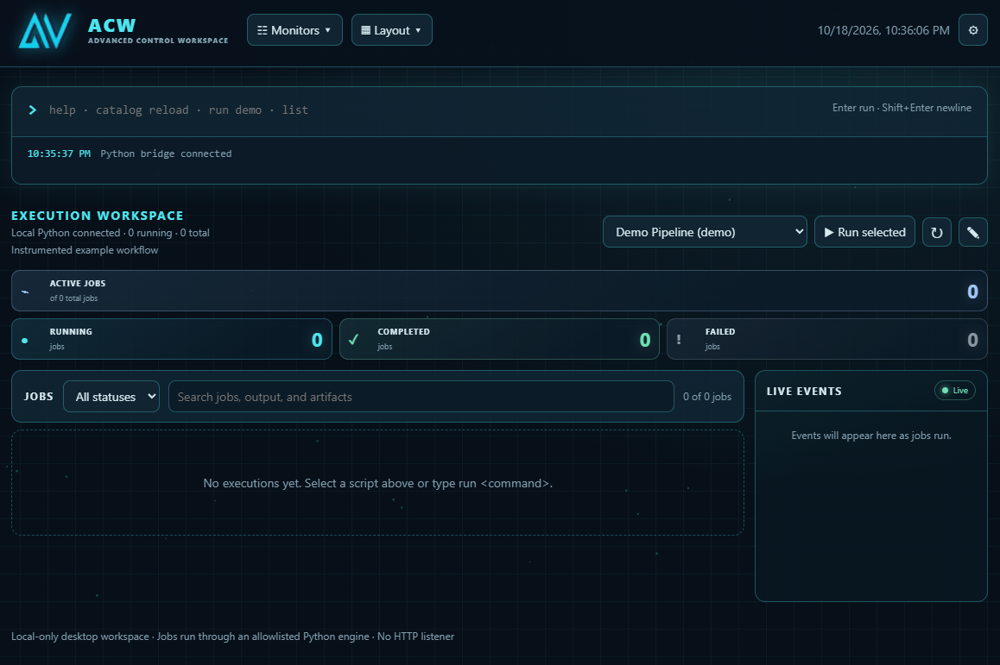
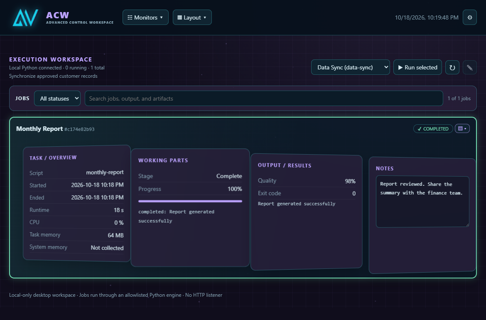
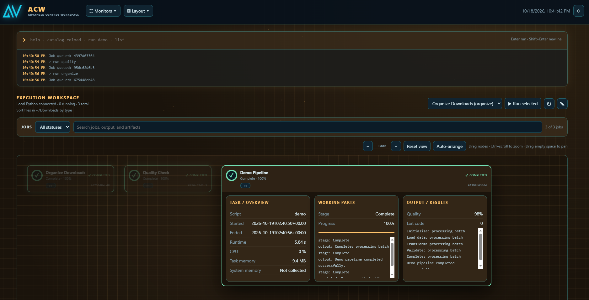
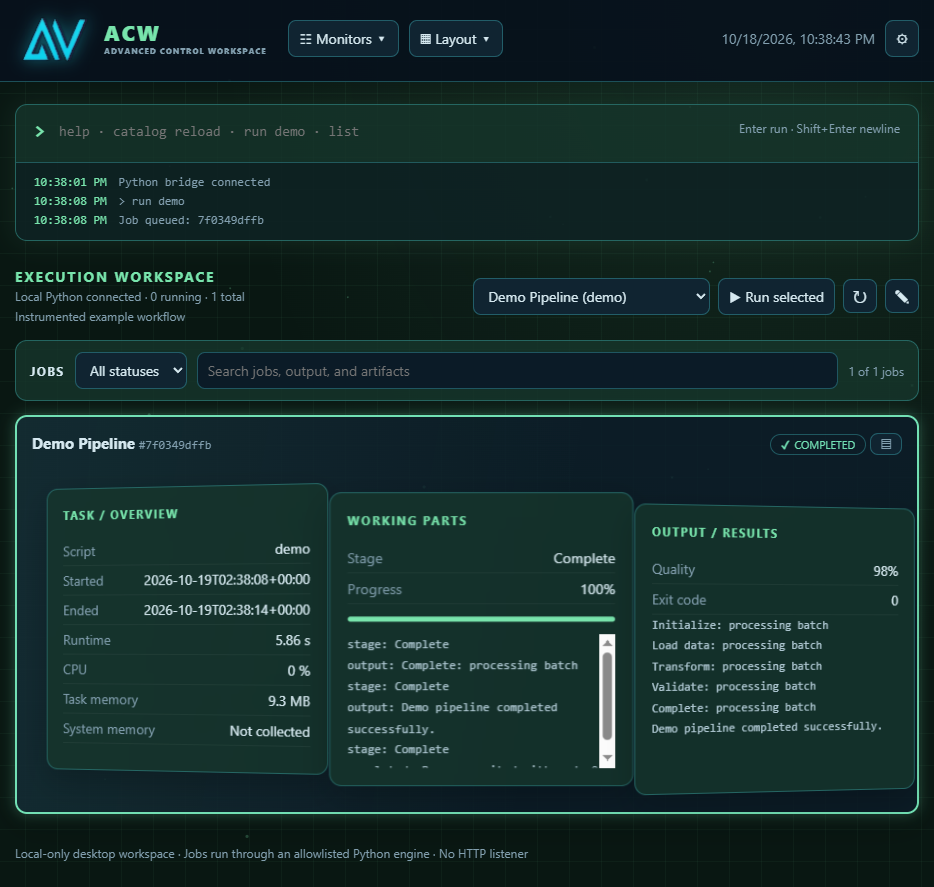

# ACW — Adaptive Context Workspace

A **local-only, command-first execution workspace** for launching approved Python scripts and observing asynchronous jobs. The frontend uses HTML5/CSS with JavaScript in a separate file, translucent panels, configurable cyberpunk themes, and multiple execution layouts. The backend runs Python scripts through a **pywebview JavaScript ↔ Python bridge**. **No FastAPI server, network listener, CDN, or cloud service is required.**

> **Status:** Early working prototype / v4 foundation. Designed for local desktop use. Not yet a hardened production job scheduler.

## Screenshots

### Cyan collapsed dashboard



### Violet layered layout



### Amber canvas layout



### Green layered layout



## Features

- Persistent toolbar with monitor checkboxes, layout selector, live date/time, and user preferences
- Expandable terminal (`Enter` executes; `Shift+Enter` inserts a newline)
- Configurable recent action history (1–20 lines)
- Job status filters and search across job details, output, events, and artifacts
- At-a-glance status cues across layouts: pulsing running jobs, green completed checks, neutral gray failures, and muted queued/cancelling states
- Real asynchronous Python subprocess execution, with a controlled script catalog
- Runtime catalog reload and argument passing to discovered scripts
- Script selector beside Run Selected, icon controls to reload scripts or open the selected script for editing, plus Exit App in Preferences
- Task → Working Parts → Output flow, with a discreet per-job notes button that opens a fourth Notes panel when needed
- Toggleable Workspace Note for session-wide focus and reminders
- Collapsed dashboard with live job totals, compact progress rows, expandable four-panel job details, and a recent-events sidebar
- ACW brand mark with the full Advanced Control Workspace name
- Collapsed dashboard, flow, layered 2.5D, and spatial Canvas layout modes
- Canvas job nodes with live progress rings, expandable details, draggable/persisted positions, pan, zoom, and auto-arrange
- Four themes (Cyan Cyberpunk default, Quantum Violet, Matrix Green, Industrial Amber)
- Glass opacity, edge glow, compact-density preferences (saved locally in the embedded webview)
- Job status, elapsed time, CPU and task memory via `psutil`, stdout, stage events, progress, and optional quality
- Job cancellation, limited concurrency, and JSON execution snapshots in `runs/`
- Safe artifact Open/Reveal actions for reported paths under the project or declared output folders
- Up/Down terminal command history and labeled, keyboard-accessible toolbar menus

## Requirements

- Python 3.10+
- Desktop OS with a supported pywebview renderer (Windows, macOS, or Linux)
- OS-specific GUI/webview dependencies may be needed on Linux; consult [pywebview installation documentation](https://pywebview.flowrl.com/guide/installation.html)

## Run locally

```bash
python -m venv .venv
```

Activate the environment:

- Windows PowerShell: `.venv\Scripts\Activate.ps1`
- macOS/Linux: `source .venv/bin/activate`

Install dependencies and launch:

```bash
python -m pip install -r requirements.txt
python main.py
```

This opens a desktop window. **Opening `ui/index.html` directly in Chrome or Edge will not connect to Python**, because the pywebview bridge is only injected into its own window.

## Console commands

```text
help
catalog
catalog reload
run <command> [arguments...]
list
layout flow
layout layered
layout collapsed
layout canvas
stop <job-id>
clear
```

Canvas is an optional fourth layout. Its nodes can be dragged with a pointer or focused and moved with the arrow keys. Select a node's title/progress control to expand or collapse its details; use the discreet notes button to open its attached notes drawer. In the Collapsed dashboard, the same button expands job details with the fourth Notes panel; in Flow and Layered layouts it adds the Notes panel to the existing task flow. Use the Canvas controls to zoom, reset the view, or auto-arrange all nodes; Ctrl+mouse wheel zooms and dragging the empty surface pans. Node positions and zoom are saved in the webview's local preferences. Canvas currently shows jobs independently; connectors and job relationships are not modeled.

Collapsed dashboard shows live running, completed, failed, and active totals above compact job rows, with recent timestamped job events in a side panel. Select a total to filter the job list; select a row's details control to expand its panels. The former standalone Collapsed mode has been replaced by this dashboard. The `layout connected` command remains as an alias for `layout collapsed`.

Per-job notes are saved by job ID and the Workspace Note is saved separately in the webview's local storage. Enable or hide the global Workspace Note from Preferences; its content is preserved when hidden. These notes stay on the local machine and are not included in execution snapshots.

Scripts in the catalog are discovered when the app starts. After saving, adding, or removing a script, hover over the reload icon beside the script selector or enter `catalog reload` to rescan the `scripts/` folder; invalid metadata is reported and leaves the existing catalog unchanged. Use the adjacent edit icon to open the selected script in a text editor. For example, `run organize --target "C:\Users\you\Downloads Archive" --dry-run` passes the remaining tokens as arguments to the organizer script. Single- or double-quoted values preserve spaces. The Run Selected button launches the selected script without arguments.

Arguments are passed as a list directly to the approved Python script; ACW does not invoke a shell. Each script decides which arguments it accepts. For example, the organizer's default target is `~/Downloads`; it accepts `--target <folder>` and `--dry-run`.

`run demo` and `run quality` start illustrative local example workflows. At most four jobs run concurrently. The terminal accepts up to 128 arguments with a combined length of 30,000 characters; each script is responsible for parsing and validating its own arguments. Job runtime, process CPU, and process memory readings are real measurements when `psutil` is available. CPU sampling is approximate. "System memory" is not currently collected and is labeled accordingly in the UI.

## Project structure

```text
acw-local/
├── main.py                  # Desktop entrypoint
├── requirements.txt
├── README.md
├── LICENSE
├── .gitignore
├── acw/
│   ├── __init__.py
│   ├── api.py                # Exposed bridge methods
│   └── engine.py             # Job registry, subprocesses, telemetry
├── ui/
│   ├── index.html            # HTML and CSS frontend
│   └── app.js                # UI behavior and pywebview bridge calls
├── scripts/
│   ├── demo_pipeline.py
│   ├── quality_check.py
│   └── organize_downloads.py
├── runs/                     # Created at startup; generated JSON snapshots
└── screenshots/              # UI captures referenced above
```

## Adding scripts

Place a trusted `.py` script in `scripts/` and add these comments near the top (within the first 20 lines):

```python
# ACW_COMMAND: my-command
# ACW_DESCRIPTION: Short explanation shown in the catalog
# ACW_LABEL: Optional friendly name shown in the UI
# ACW_OUTPUT_DIR: Optional external output folder (project-relative or absolute)
```

`ACW_COMMAND` and `ACW_DESCRIPTION` are required; `ACW_LABEL` is optional and defaults to a title-cased command. `ACW_OUTPUT_DIR` may be repeated to declare output folders eligible for artifact actions. Commands use lowercase letters, numbers, and hyphens, and must be unique. Run `catalog reload` to discover additions or metadata changes without restarting the app, then run one using `run my-command [arguments...]` or select it in the UI. For arguments containing spaces, use single or double quotes, for example `run organize --target "C:\My Downloads"`. Quotes are removed by the terminal parser; no shell expansion or shell execution occurs. Scripts without ACW metadata are not exposed.

The process runner uses `shell=False` and only launches scripts discovered in the `scripts/` folder. Only add scripts you trust: they execute with your user account's privileges.

### Optional structured progress events

Scripts can print a JSON event on its own line to report stage/progress/quality:

```python
import json
print('ACW_EVENT:' + json.dumps({
    'stage': 'Validation', 'progress': 70, 'quality': 98
}), flush=True)
```

Any other stdout line is treated as ordinary process output. The engine retains up to 250 output lines and 250 events per job in memory. When starting a job pushes the in-memory history past 100 records, it prunes one record that is not queued or running; the history can exceed 100 if no such record is available. When a launched process exits, its job snapshot is written to `runs/<job-id>.json` (ignored by Git). Snapshots are for local inspection and are not reloaded into the UI on the next launch.

Scripts may emit progress updates while they run; when a script exits successfully, the engine marks its stage as `Complete` and progress as 100%.

To expose an artifact path for safe Open/Reveal actions, scripts can emit it in a structured event:

```python
print('ACW_EVENT:' + json.dumps({
    'artifact': 'reports/result.pdf'
}), flush=True)
```

Relative artifact paths are resolved from the project root. For an output directory outside the project, declare one in the script header with `# ACW_OUTPUT_DIR: D:/path/to/output` (or a project-relative path). Artifact actions are available only for paths reported by that job and inside the project or its declared output directories. Open is limited to common document, image, and archive formats; other files can still be revealed in the file manager.

## Keyboard and accessibility

- **Enter** runs the terminal command; **Shift+Enter** inserts a new line.
- **Up/Down** navigates command history when the caret is on the first/last line.
- In Canvas layout, drag a node or focus its header and use the arrow keys to reposition it.
- Floating toolbar menus announce their expanded state and return focus to the trigger when closed with **Escape**.

## Architecture and limitations

- **No listening service:** Python and the HTML frontend communicate through pywebview's local JavaScript API bridge.
- **Concurrent execution:** Jobs run as subprocesses in background threads, so the UI remains responsive.
- **Local persistence:** Preferences and notes use webview localStorage; exited-job snapshots are JSON files under `runs/` and are not restored into the UI.
- **Security boundary:** This is a local desktop app, not a sandbox. Scripts can access resources available to the current OS user. Do not add untrusted scripts to the catalog.
- **Cancellation:** Attempts to terminate the job and child processes. Some subprocess trees may require additional platform-specific cleanup.
- **Telemetry:** Best-effort CPU/memory sampling, not a full tracing or profiling system. Stage timing, per-stage resources, input versioning, file verification, historical comparison, and multi-step workflow DAGs are future work.
- **Rendering:** Layered mode uses CSS perspective, not a WebGL engine.
- **Platform testing:** Behavior can vary across desktop webview engines; validate on your target OS before relying on it for critical jobs.

## Roadmap

- [ ] Configurable script definitions and argument schemas
- [x] Job filtering and search
- [ ] Stage-level timing and metrics, resource graphs, and comparison views
- [x] Safe artifact Open/Reveal actions for reported artifacts
- [ ] More robust process-tree cancellation, timeouts, and job persistence
- [ ] Workflow dependencies and agent/tool-call telemetry
- [ ] Automated tests and desktop packaging

## License

This project is licensed under the MIT License. See [LICENSE](LICENSE).
