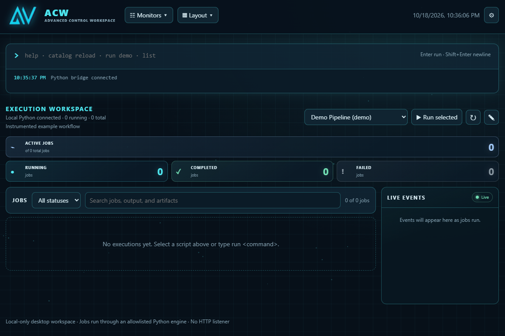
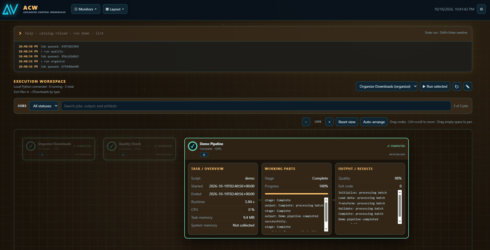

# ACW — Advanced Control Workspace

A **local-only, command-first execution workspace** for launching approved Python scripts and observing asynchronous jobs. The frontend uses HTML5/CSS with JavaScript in a separate file, translucent panels, configurable cyberpunk themes, and two execution layouts. The backend runs Python scripts through a **pywebview JavaScript ↔ Python bridge**. **No FastAPI server, network listener, CDN, or cloud service is required.**

> **Status:** Early working prototype / v4 foundation. Designed for local desktop use. Not yet a hardened production job scheduler.

## Archived screenshots

These captures show an earlier UI and do not reflect the current layout and spacing.

### Cyan collapsed dashboard


### Amber canvas layout


## Features

- Persistent toolbar with monitor checkboxes, layout selector, live date/time, and user preferences
- Expandable terminal (`Enter` executes; `Shift+Enter` inserts a newline)
- Configurable recent action history (1–20 lines)
- Job status filters and search across job details, events, and artifacts
- At-a-glance status cues across layouts: pulsing running jobs, green completed checks, neutral gray failures, and muted queued/cancelling states
- Real asynchronous Python subprocess execution, with a controlled script catalog
- Runtime catalog reload and argument passing to discovered and registered scripts
- Script selector beside Run Selected, controls to reload scripts or open the selected script for editing, plus Exit App in Preferences
- Task → Working Parts → Final Results details, with in-progress telemetry separated from finished results and artifacts
- Manage Work page for registering trusted scripts in place and setting their working directories
- Read-only Log Audit page for current-launch jobs and explicit searches of stored run details
- Collapsed dashboard with compact live job totals, progress rows, expandable job details, and a recent-events sidebar
- ACW brand mark with the full Advanced Control Workspace name
- Collapsed dashboard and spatial Canvas layout modes
- Canvas job nodes with live progress rings, expandable details, draggable/persisted positions, pan, zoom, and auto-arrange
- Four themes (Cyan Cyberpunk default, Quantum Violet, Matrix Green, Industrial Amber)
- Glass opacity, edge glow, compact-density preferences (saved locally in the embedded webview)
- Job status, elapsed time, CPU and task memory via `psutil`, stdout, stage events, progress, and optional quality
- Progress-based **ETA** and historical average duration per script, shown on job cards
- Per-stage timing when scripts emit structured stage events
- Configurable concurrency limit (default 4) with a FIFO queue for overflow jobs
- Workspace session auto-save on exit and restore on next launch; named session save/load/clear
- Lightweight run history index (`runs/history.jsonl`) with `history` and `compare` commands
- Job cancellation (including queued jobs), JSON execution snapshots in `runs/`
- Safe artifact Open/Reveal actions for reported paths under the project or declared output folders
- Up/Down terminal command history and labeled, keyboard-accessible toolbar menus

## Requirements

- Python 3.10+
- Desktop OS with a supported pywebview renderer (Windows, macOS, or Linux)
- OS-specific GUI/webview dependencies may be needed on Linux; consult [pywebview installation documentation](https://pywebview.flowrl.com/guide/installation.html)

## Run locally

```bash
python -m venv .venv
```

Activate the environment:

- Windows PowerShell: `.venv\Scripts\Activate.ps1`
- macOS/Linux: `source .venv/bin/activate`

Install dependencies and launch:

```bash
python -m pip install -r requirements.txt
python main.py
```

This opens a desktop window. **Opening `ui/index.html` directly in Chrome or Edge will not connect to Python**, because the pywebview bridge is only injected into its own window.

## Console commands

```text
help
catalog
catalog reload
run <command> [arguments...]
list
layout collapsed
layout canvas
stop <job-id>
clear
session save [name]
session load <name>
session list
session clear
history [script]
compare <script>
concurrent
concurrent <N>
```

Canvas is an optional layout. Its nodes can be dragged with a pointer or focused and moved with the arrow keys. Select a node's title/progress control to expand or collapse its details. Use the Canvas controls to zoom, reset the view, or auto-arrange all nodes; Ctrl+mouse wheel zooms and dragging the empty surface pans. Node positions and zoom are saved in the webview's local preferences. Canvas currently shows jobs independently; connectors and job relationships are not modeled.

Collapsed is the default dashboard layout, showing compact running, completed, and failed totals beside the script selector, with recent timestamped job events in a side panel. Select a total to filter the job list; select a row's details control to expand its panels. The `layout connected` command is an alias for `layout collapsed`.

Scripts in `scripts/` are discovered when the app starts. Use **Manage Work** in the top bar to register an existing `.py` file without copying or modifying it. ACW saves its absolute path and working directory in `runs/registered_scripts.json`; the default working directory is the script's parent folder. A missing or moved script appears as unavailable until relinked. The reload icon beside the selector or `catalog reload` rescans `scripts/` and refreshes the catalog. Use the adjacent edit icon to open the selected script in a text editor. For example, `run organize --target "C:\Users\you\Downloads Archive" --dry-run` passes the remaining tokens as arguments to the organizer script. Single- or double-quoted values preserve spaces. The Run Selected button launches the selected script without arguments.

Arguments are passed as a list directly to the approved Python script; ACW does not invoke a shell. Each script decides which arguments it accepts. For example, the organizer's default target is `~/Downloads`; it accepts `--target <folder>` and `--dry-run`.

Use **Log Audit** in the top bar to inspect jobs started since the current app launch, including captured output, events, errors, and reported artifact paths. Restored jobs from earlier launches are excluded from this default view. Select **Search stored runs** and enter a search term to find matches in existing per-job snapshots, saved sessions, and the successful-run history index. Audit is read-only and does not scan directories or create a complete history; details for older failed or interrupted runs may not have been saved. Each job card's **Audit** action opens the matching current-session record or searches stored runs by that job ID.

`run demo` and `run quality` start illustrative local example workflows. The concurrency limit defaults to 4 and is configurable (`concurrent <N>` or the Preferences slider). When the limit is reached, additional jobs enter a FIFO queue and start automatically when a slot opens. The terminal accepts up to 128 arguments with a combined length of 30,000 characters; each script is responsible for parsing and validating its own arguments. Job runtime, process CPU, and process memory readings are real measurements when `psutil` is available. CPU sampling is approximate. "System memory" is not currently collected and is labeled accordingly in the UI.

### Sessions and history

- On exit (and after job completions), the current job list is written to `runs/last_session.json` and restored on the next launch. Jobs that were running or queued are marked `interrupted`.
- Named sessions can be saved under `sessions/` via `session save [name]` or the Preferences button. Load with `session load <name>` (refuses while jobs are active). List with `session list`. Clear the workspace with `session clear`.
- Successful runs append a compact record to `runs/history.jsonl` (script name, duration, peak memory, exit code, quality, timestamp, stage timings). Use `history [script]` and `compare <script>` to inspect recent runs and averages.
- Job cards show a progress-based **ETA** when progress &gt; 0, and a historical average duration when prior successful runs exist for that script.

## Project structure

```text
acw-local/
├── main.py                  # Desktop entrypoint
├── requirements.txt
├── README.md
├── LICENSE
├── .gitignore
├── acw/
│   ├── __init__.py
│   ├── api.py                # Exposed bridge methods
│   └── engine.py             # Job registry, subprocesses, telemetry, sessions, history
├── ui/
│   ├── index.html            # HTML and CSS frontend
│   └── app.js                # UI behavior and pywebview bridge calls
├── scripts/
│   ├── demo_pipeline.py
│   ├── quality_check.py
│   └── organize_downloads.py
├── runs/                     # Created at startup
│   ├── <job-id>.json         # Per-job snapshots
│   ├── last_session.json     # Auto-restored workspace
│   └── history.jsonl         # Append-only run index
├── sessions/                 # Named workspace snapshots (created on first save)
└── screenshots/              # UI captures referenced above
```

## Adding scripts

Place a trusted `.py` script in `scripts/` and add these comments near the top (within the first 20 lines):

```python
# ACW_COMMAND: my-command
# ACW_DESCRIPTION: Short explanation shown in the catalog
# ACW_LABEL: Optional friendly name shown in the UI
# ACW_OUTPUT_DIR: Optional external output folder (project-relative or absolute)
```

`ACW_COMMAND` and `ACW_DESCRIPTION` are required for automatic discovery; `ACW_LABEL` is optional and defaults to a title-cased command. `ACW_OUTPUT_DIR` may be repeated to declare output folders eligible for artifact actions. Commands use lowercase letters, numbers, and hyphens, and must be unique. Run `catalog reload` to discover additions or metadata changes without restarting the app, then run one using `run my-command [arguments...]` or select it in the UI. For arguments containing spaces, use single or double quotes, for example `run organize --target "C:\My Downloads"`. Quotes are removed by the terminal parser; no shell expansion or shell execution occurs. Scripts without metadata can be registered through Manage Work.

The process runner uses `shell=False` and only launches scripts in the approved catalog. Only add scripts you trust: they execute with your user account's privileges. Registered scripts run from their saved working directory. Registering a script does not add its folder to the artifact Open/Reveal allowlist.

### Optional structured progress events

Scripts can print a JSON event on its own line to report stage/progress/quality:

```python
import json
print('ACW_EVENT:' + json.dumps({
    'stage': 'Validation', 'progress': 70, 'quality': 98
}), flush=True)
```

Any other stdout line is treated as ordinary process output. The engine retains up to 250 output lines and 250 events per job in memory. When a launched process exits, its job snapshot is written to `runs/<job-id>.json` (ignored by Git). Successful completions also append a compact record to `runs/history.jsonl` for averages and comparison.

Scripts may emit progress updates while they run; when a script exits successfully, the engine marks its stage as `Complete` and progress as 100%. Changing the `stage` value records the duration of the previous stage for display on the job card.

To expose an artifact path for safe Open/Reveal actions, scripts can emit it in a structured event:

```python
print('ACW_EVENT:' + json.dumps({
    'artifact': 'reports/result.pdf'
}), flush=True)
```

Relative artifact paths are resolved from the project root. For an output directory outside the project, declare one in the script header with `# ACW_OUTPUT_DIR: D:/path/to/output` (or a project-relative path). Artifact actions are available only for paths reported by that job and inside the project or its declared output directories. Open is limited to common document, image, and archive formats; other files can still be revealed in the file manager.

## Keyboard and accessibility

- **Enter** runs the terminal command; **Shift+Enter** inserts a new line.
- **Up/Down** navigates command history when the caret is on the first/last line.
- In Canvas layout, drag a node or focus its header and use the arrow keys to reposition it.
- Floating toolbar menus announce their expanded state and return focus to the trigger when closed with **Escape**.

## Architecture and limitations

- **No listening service:** Python and the HTML frontend communicate through pywebview's local JavaScript API bridge.
- **Concurrent execution:** Jobs run as subprocesses in background threads, so the UI remains responsive. A configurable concurrency limit (default 4) is enforced; overflow jobs wait in a FIFO queue.
- **Local persistence:** Preferences and selected script use webview localStorage. Registered script paths and working directories are saved in `runs/registered_scripts.json`. The job list is auto-saved to `runs/last_session.json` and restored on the next launch. Named sessions live under `sessions/`. Successful run metrics are appended to `runs/history.jsonl`.
- **Security boundary:** This is a local desktop app, not a sandbox. Scripts can access resources available to the current OS user. Do not add untrusted scripts to the catalog.
- **Cancellation:** Attempts to terminate the job and child processes; queued jobs can be removed without starting. Some subprocess trees may require additional platform-specific cleanup.
- **Telemetry:** Best-effort CPU/memory sampling and progress-based ETA, not a full tracing or profiling system. Stage timing is derived from structured events. Resource graphs, input versioning, file verification, and multi-step workflow DAGs remain future work.
- **Platform testing:** Behavior can vary across desktop webview engines; validate on your target OS before relying on it for critical jobs.

## Roadmap

- [ ] Configurable script definitions and argument schemas
- [x] Job filtering and search
- [x] Stage-level timing and historical comparison (`history` / `compare`)
- [x] Safe artifact Open/Reveal actions for reported artifacts
- [x] Job list persistence across launches and named workspace sessions
- [x] Configurable concurrency with queue
- [ ] More robust process-tree cancellation and timeouts
- [ ] Resource graphs and richer comparison views
- [ ] Workflow dependencies and agent/tool-call telemetry
- [ ] Automated tests and desktop packaging

## License

This project is licensed under the MIT License. See [LICENSE](LICENSE).
